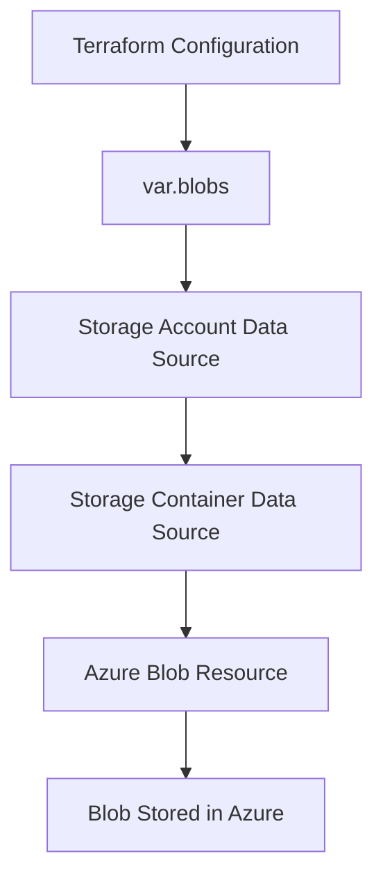

# Azure Blob Storage Automation with Terraform

[](https://www.google.com/search?q=Microsoft+Azure+Cloud+Infrastructure) [](https://www.google.com/search?q=Terraform+Infrastructure+as+Code) [](https://www.google.com/search?q=GitHub+Version+Control)

## 📌 Project Overview

This repository demonstrates how to manage Azure Blob Storage using Terraform and Infrastructure as Code (IaC).

It uses Terraform data sources to retrieve an existing Azure Storage Account and Storage Container, then references those resources in the blob configuration. The `for_each` meta-argument supports multiple blob configurations through a map variable.

This project is part of a modular Azure infrastructure setup for a Loan Management System.

## 🏗️ Architecture



## ☁️ Azure Resource Details

| Property | Value |
|---|---|
| Cloud Provider | Microsoft Azure |
| IaC Tool | Terraform |
| Storage Account | `stlmsidndev001` |
| Container | `loan-documents` |
| Example Blob | `loan-application-sample.pdf` |
| Container Access | Private |

*Verify these values against your current Terraform configuration and Azure Portal.*

## 📂 Repository Structure

```text
terraform-azure-blob/
├── main.tf
├── variables.tf
├── terraform.tfvars
├── provider.tf
├── .gitignore
└── README.md
```

## ⚙️ Terraform Configuration

### 1. Storage Account Data Source

Retrieves information about an existing Azure Storage Account.

```hcl
data "azurerm_storage_account" "storage_account" {
  for_each = var.blobs

  name                = each.value.storage_account_name
  resource_group_name = each.value.resource_group_name
}
```

### 2. Storage Container Data Source

Retrieves the existing container by referencing the matching Storage Account ID.

```hcl
data "azurerm_storage_container" "container" {
  for_each = var.blobs

  name               = each.value.container_name
  storage_account_id = data.azurerm_storage_account.storage_account[each.key].id
}
```

### 3. Azure Blob Resource

The following is an illustrative example of a block blob resource. Match the attribute names with your actual `variables.tf` and `terraform.tfvars`.

```hcl
resource "azurerm_storage_blob" "blob" {
  for_each = var.blobs

  name                   = each.value.blob_name
  storage_account_name   = data.azurerm_storage_account.storage_account[each.key].name
  storage_container_name = data.azurerm_storage_container.container[each.key].name
  type                   = "Block"
  source                 = each.value.source
}
```

**Key properties:**

- `for_each` — manages multiple blob configurations.
- `name` — sets the blob name in Azure Storage.
- `storage_account_name` — references the existing Storage Account.
- `storage_container_name` — references the existing container.
- `type` — specifies a block blob.
- `source` — identifies the local file to upload.

## 🔄 How It Works

1. Terraform reads the blob configuration from `var.blobs`.
2. The Storage Account data source looks up the existing account.
3. The Storage Container data source looks up the existing container.
4. The blob resource references those existing resources.
5. Terraform plans and applies the requested blob changes.

## 🚀 Deployment Guide

### Prerequisites

- An Azure subscription
- Terraform installed
- Azure CLI installed
- Appropriate Azure permissions
- The referenced Storage Account and Container already exist
- The local file specified by `source` exists

### Step 1 — Login to Azure

```powershell
az login
```

### Step 2 — Initialize Terraform

```powershell
terraform init
```

### Step 3 — Validate Configuration

```powershell
terraform validate
```

### Step 4 — Review the Plan

```powershell
terraform plan
```

### Step 5 — Apply Configuration

```powershell
terraform apply
```

Review the proposed changes and approve the plan when prompted.

## 🔍 Verify in Azure Portal

1. Open the Azure Portal.
2. Navigate to **Storage accounts**.
3. Open the configured Storage Account.
4. Select **Data storage → Containers**.
5. Open the configured container.
6. Verify that the expected blob has been uploaded.

## 🔐 Security & Best Practices

- Keep containers private unless public access is required.
- Use Azure RBAC and least-privilege permissions.
- Never commit secrets, credentials, or storage access keys to GitHub.
- Use variables to keep configuration reusable.
- Review `terraform plan` before applying changes.
- Ensure local source file paths are correct.
- Configure remote Terraform state when shared state is required.

## 🎯 Key Learnings

- Azure Blob Storage management using Terraform.
- Referencing existing Azure resources with data sources.
- Using `for_each` with map variables.
- Connecting resources through Terraform references.
- Managing infrastructure with reusable IaC configuration.

## 👩‍💻 Author

**Sharanjeet Kaur**

Azure Cloud | Terraform | Azure DevOps | Infrastructure as Code

## 🏷️ Tags

`Azure` `Terraform` `Blob Storage` `Block Blob` `Data Sources` `for_each` `DevOps` `IaC`
